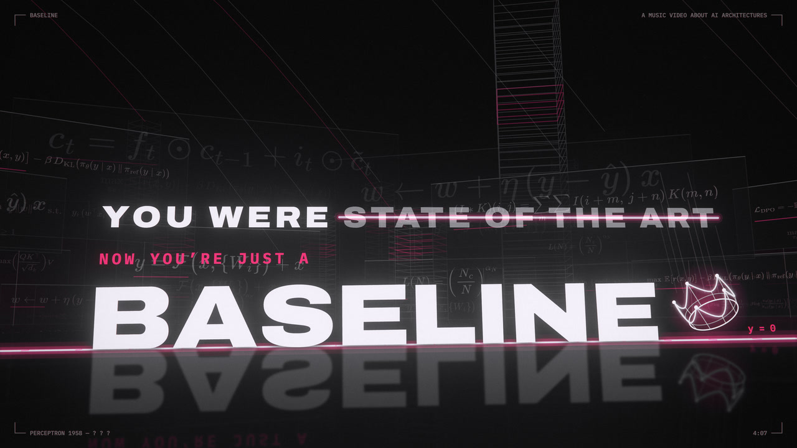

# Baseline

[](https://youtu.be/Qy3_4oXoS6c)

**▶ 觀看 4K 影片：https://youtu.be/Qy3_4oXoS6c**

一支 4 分 07 秒的音樂影片，主題是 AI 架構怎麼登上 state of the art、又怎麼被下一代擠成 baseline：
感知器、SVM、卷積、RNN／LSTM、注意力、GAN、diffusion、MoE、量化、LoRA、RLHF／DPO、FlashAttention、長上下文……

> You were state of the art, now you're just a baseline.
> Top of the leaderboard, until the next deadline.

## 故事

〈Baseline〉是一首寫給 AI 架構的分手歌。唱歌的是一個曾經登上排行榜第一名的模型，它唱給每一個被擠下去的前任聽，最後也輪到它自己。

這首歌從 1958 年唱到現在。每句歌詞點名一個技術，畫面就用那個技術最直接、看得懂的樣子演出來；而每個技術的下場都一樣：登上第一名，然後變成別人論文裡拿來比較的那條 baseline。

### 第一條線（0:00–0:45）

黑暗裡，一台繪圖機畫下全片的第一條線 y = 0。這條線就是 baseline，之後每個被超越的冠軍都會摔回這條線上。

感知器用一條直線切開了 AND 和 OR，卻怎麼也切不開 XOR，直到多疊一層隱藏層。sigmoid 把訊號壓扁，梯度往回穿過六層，每層乘上 ¼，直到歸零；ReLU 一刀切掉負半邊，梯度原封不動地傳回來。手工雕刻的 HOG 和 SIFT 被卷積取代：牆上 96 個濾波器從雜訊裡自己長出來，沒有人設計過它們（它們真的在 CIFAR-10 上訓練過）。SVM 撐開最寬的間隔，核技巧把圓環抬進碗裡一刀切開；但 ImageNet 的錯誤率，被深度網路一年一年壓了下去。

### 宣言，與排行榜

每段主歌之後，都有人宣布：「X is all you need, the abstract guaranteed.」

這句宣言出現四次，每次都用那個成分自己的結構寫出來：
- DEPTH 是一口 152 層的豎井；
- MEMORY 是一排 LSTM 細胞的點陣；
- ATTENTION 是四塊磚之間的注意力弧線；
- SCALE 是對數座標上、一次放大十倍的字。

最後一塊黑玻璃石碑砸下，雷射刻出 GUARANTEED，蓋上洋紅色的 ∎（證畢）。鏡頭推進這個 ∎，直到整個畫面都是洋紅，副歌就從裡面拉開。

副歌是排行榜。冠軍板上寫著巨大的 STATE OF THE ART；挑戰者砸上塔頂，舊冠軍的名牌一路往下摔，落地的瞬間洋紅淹過地板：BASELINE。鏡頭再升回榜首，倒數在 DEADLINE 上歸零。四次副歌換了四個排行榜，一次比一次重：
- ILSVRC 的錯誤率
- WMT14 的 BLEU
- LAMBADA 的正確率（只有這次很安靜，名牌被輕輕放下）
- 參數量

### 夜車（1:00–1:59）

第二段主歌是一列夜車，每節車廂是一個唱到的字。n-gram 只看得見三個字寬的窗，RNN 把隱藏狀態帶在身上，時間反向傳播的梯度在分岔口消失或爆炸，LSTM 沿路裝上閘門。seq2seq 把整句話擠過一個瓶頸，注意力讓解碼器回頭再看一次。這些模型處理的，都是這首歌自己。然後 transformer 一次全部平行跑完，鏡頭升空，把夜車留在下面。

副歌之後，LSTM 的細胞一路展開到地平線，記憶沿著 cell state 跑了很久很久；一層注意力像玻璃板一樣砸下，迴圈一個個斷掉：GONE。

### 實驗室（1:59–2:50）

第三段主歌是一間實驗室，裡面每樣東西都在被取代：
- GAN 的雙人遊戲，一路玩到模態崩塌成一根尖峰；diffusion 花一千步，把雜訊去成字。
- 正弦位置編碼讓位給 RoPE 的旋轉，LayerNorm 讓位給 RMSNorm，ReLU 讓位給 SwiGLU。
- 稠密網路變成專家混合，八座塔只醒兩座；32 位元降到 4 位元。
- 全參數微調縮成一小片低秩的 LoRA；最後連梯度都不用了，只在 context 裡寫提示。

BERT 曾經從兩個方向讀；只看過去的 decoder-only 卻一路放大到 175B，BERT 縮成一個勾選框：OPTIONAL。

### 工廠與磁帶（2:50–3:19）

橋段裡，RLHF 的獎勵模型替答案排名次，DPO 用吊車把中間人吊走；FlashAttention 把運算分塊搬進 SRAM，通往 HBM 的路從塞車變成暢通。

上下文視窗從 2K 一路翻倍到一百萬。鋪在地上的磁帶，是這首歌自己的 token；乾草堆裡那根針是第 0 個 token，也就是這部片唱的第一個字 Perceptron 的 P。

四句宣言刻上真實的論文日期，排上時間軸。每個紀錄都比上一個高，被超越的就變灰，成了下一個要打敗的虛線 baseline。NOW 停在 2026，再往右，是三個還沒有名字的「?」。

### 墜落（3:19–4:07）

SCALE 的冪律每唱一個字就退後十倍，超出資料的部分變成虛線。注意力的方陣每一拍面積翻四倍，直到衝出畫面；旁邊一條 O(n) 的掃描線，還在訓練。

音樂停下。所有宣言縮成註腳，這部片唱過的每個名字刻上紀念牆。

最後一次排行榜，整部片的冠軍疊成一座塔：PERCEPTRON 1958 在最底，戴著王冠的 TRANSFORMER 2017 在最頂。一個空白的 ? ? ? 砸上塔頂，這次掉下來的是歌者自己：

> I was state of the art, now I'm just a baseline.

名牌平躺在 baseline 上，地面變回第一個鏡頭的藍圖。繪圖機回來，在舊線旁邊畫下一條新的：ONE MORE TIME。最後一格，就是第一格。

## 畫面是怎麼做出來的

**每一格都是歌曲時間的純函數。** Canvas2D 上的針孔相機用 2D 畫出 3D，再交給 WebGL 做後製。沒有用剪輯軟體，也沒有手擺的關鍵影格。

**歌詞是場景裡的物件。** 它們刻在石碑上、寫在車廂側面、鋪在地板上，全片沒有字幕條。

**畫面上的數字都是真的計算結果：**
- 用 CIFAR-10 訓練的 conv1 濾波器
- SVM 擬合、BPTT 梯度、LSTM 閘門
- GAN 模式崩塌、MoE 路由、INT4 量化、LoRA rank-8
- Bradley–Terry 獎勵、FlashAttention 分塊、needle-in-a-haystack

**背景是公式城市。** 城市牆上的 71 條公式取自原始論文。

## 文件

| 文件 | 內容 |
| --- | --- |
| [docs/DESIGN.md](docs/DESIGN.md) | 設計：原則、色彩、字、鏡頭、公式城市、四種重複結構、封面 |
| [docs/SHOTLIST.md](docs/SHOTLIST.md) | 分鏡表：25 個場景、118 個鏡頭，每個鏡頭的時間、唱到的字與畫面；[docs/frames/](docs/frames/) 是每秒一格的縮圖 |
| [docs/MAKING.md](docs/MAKING.md) | 怎麼做的：歌、逐字對齊、真實資料、公式、引擎架構、算圖、品質檢查、改版歷程 |
| [docs/DESCRIPTION.md](docs/DESCRIPTION.md) | 影片簡介（中英）、章節、歌詞、製作名單、標籤 |

## 目錄

| 路徑 | 內容 |
| --- | --- |
| `app/src/engine/` | 引擎：時間軸、動態模糊、後製、轉場、歌詞與節拍資料 |
| `app/src/scenes/` | 場景：`_v.ts` 是共用的相機與排字工具，`v_*.ts` 是各段畫面 |
| `app/src/timeline.ts`、`direction.ts` | 各段落用哪個場景，以及鏡頭撞擊與轉場 |
| `app/scripts/render.ts` | 算圖、截圖、聯絡表、文字重疊檢查 |
| `app/public/data/` | 畫面用的計算結果（由 `tools/data/` 的腳本產生） |
| `app/eq.json` | 畫面上的 71 條公式（TeX，取自各篇原始論文）；`bun scripts/eq.ts` 用 MathJax 排版成 `public/eq/` |
| `analysis/` | 逐字對齊與節拍分析 → `data/lyrics.json`、`data/audio.json` |
| `tools/` | 資料產生腳本：conv1 訓練、BPE 等（環境：`tools/requirements.txt`）；`tools/video/` 把重算的一小段無損接回 4K 母帶 |
| `cover/` | 封面（3840 × 2160 PNG、1280 × 720 JPG），由 `app/src/scenes/cover.ts` 算出 |
| `docs/` | 設計、分鏡、製作說明、影片簡介 |
| `audio/baseline.wav` | 歌曲（不在 MIT 範圍內，見下方授權） |
| `lyrics/suno-v4.txt` | 歌詞（不在 MIT 範圍內） |

## 執行

需要 [Bun](https://bun.sh) 與 ffmpeg。

```bash
cd app
bun install
bunx vite                                   # 在瀏覽器即時預覽
bun scripts/render.ts video --fps 60 --samples auto --max-samples 108 --crf 17 --out ../out/Baseline.mp4
```

加 `--scale 2` 就是真 4K（3840×2160，版面不變、只是解析度加倍）；成片就是這樣算的（4K60：母帶約 17 GB、上傳版約 2.6 GB，太大所以不放進 repo，`out/` 在 .gitignore 裡）。
其他模式：`stills --t 18.9,19.2`（單張截圖）、`sheet --from 20 --to 35 --cols 4`（聯絡表）、
`textqa --from 0 --to 247.2`（逐字形檢查全片文字有沒有重疊）。

## 授權

**程式碼、場景、工具、資料與文件：** 採 [MIT 授權](LICENSE)，歡迎拿去學、改、用。

**歌曲〈Baseline〉本身不在 MIT 範圍內。** 這包括錄音 `audio/baseline.wav` 與歌詞 `lyrics/`，© 2026 Tunai，保留權利，詳見 [LICENSE-SONG.md](LICENSE-SONG.md)。歌曲以 Suno 付費方案生成。

**第三方元件：**
- 部分引擎與分析工具改寫自 [mexicat/pdoom-video](https://github.com/mexicat/pdoom-video)（MIT，原授權保留在 `licenses/pdoom-video-MIT.txt`）。
- 字型採 SIL Open Font License 1.1。

以上詳見 [THIRD_PARTY_NOTICES.md](THIRD_PARTY_NOTICES.md)。
